<p align="center"></p>

# Clear cell kidney cancer, cell by cell: a single-cell RNA-seq analysis in the LSMA Analysis Lab

**Which cells make up a clear cell kidney tumour, and which of them carry the tumour's hypoxia programme?**

This repository is a worked example from the **LSMA Analysis Lab**, the analysis platform of the [London School of Multiomics & AI](https://lsma.co.uk). The full analysis was run in the lab, without writing code: import from a public atlas, quality control, normalisation, integration across patients, clustering, cell-type annotation, pathways, transcription-factor activity, cell-cell communication, trajectory and cell cycle. The report, figures and tables it produced are here, with two validation checks.

| | |
|---|---|
| **Data** | Clear cell renal cell carcinoma atlas (Zhang et al., *PNAS* 2021), from [CELLxGENE](https://cellxgene.cziscience.com/e/be39785b-67cb-4177-be19-a40ee3747e45.cxg/) |
| **Cells** | 20,509 cells from 7 patients (10x Genomics 3′ v2); 19,189 after quality control |
| **Lab module** | Single-cell RNA-seq (workflow version 1.0.0) |
| **Lab run time** | **12 min 52 s** for the whole analysis, including the optional stages (plus 20 s to import the data from CELLxGENE) |
| **Validation** | The authors' own cell labels, and the genes found in the bulk kidney cancer analysis ([companion repository](https://github.com/MultiOmics-Intelligence/lsma-lab-bulk-rnaseq-kidney-cancer-tcga-kirc)) |
| **Result** | The lab's labels agree with the authors' for **98.4%** of cells; the bulk tumour genes sit in the **tumour cells** |

---

## Biological question and aim

**Question.** A bulk analysis of kidney tumours (our companion repository) showed hypoxia genes such as *CA9* switched on, and a strong immune signal. Bulk tissue mixes many cell types, so it can't say *which* cells are responsible. Which cells make up a clear cell kidney tumour, and where do those signals come from?

**Hypothesis.**
- The hypoxia genes switched on by the loss of *VHL* should be expressed by the **cancer cells themselves**.
- The immune signal should come from a large population of **immune cells living inside the tumour**.

**Aims**
1. Describe every cell population in 20,509 cells from 7 patients' tumours, with the cells from different patients integrated so the same cell types group together.
2. Label each population from its marker genes, using a marker panel that fits a solid tumour.
3. Check the labels against the labels the original authors assigned by hand.
4. Check that the genes the bulk analysis found higher in tumours are carried by the tumour cells.
5. Show each step as it is run in the LSMA Analysis Lab, so a student can repeat it.

---

## Background: why single cells?

A **bulk RNA-seq** experiment grinds a piece of tissue and measures the *average* activity of each gene. That's powerful, but a tumour isn't one kind of cell. It is a mixture of cancer cells with immune cells, blood vessels and supporting stromal cells. When a gene rises in bulk, we don't know which of those cells changed.

**Single-cell RNA-seq** measures each cell separately, thousands at a time, so cell types can be found and compared directly. That makes it the natural next question after the bulk analysis.

**Clear cell renal cell carcinoma (ccRCC)** is the most common kidney cancer.
- **The hypoxia programme:** most tumours lose the *VHL* gene, which leaves the cell's hypoxia programme switched on. Its hallmarks include *CA9*, *NDUFA4L2*, *VEGFA* and *EGLN3*.
- **Blood vessels:** VEGF drives the dense blood-vessel network these tumours are known for.
- **Immune cells:** ccRCC is among the most immune-infiltrated cancers, rich in T cells and especially macrophages.
- **Treatment:** this is why both anti-angiogenic drugs and immune checkpoint therapy are used to treat it.

---

## Key findings

1. **Ten cell populations, clearly separated** (Figure 1). Of 19,189 high-quality cells:

   | Population | Cells | Share |
   |---|---|---|
   | Tumour cells | 7,999 | 42% |
   | Endothelial (blood-vessel) cells | 3,004 | 16% |
   | Pericytes and smooth muscle | 2,678 | 14% |
   | Macrophages | 2,628 | 14% |
   | CD8 T cells | 1,067 | 6% |
   | Monocytes | 854 | 4% |
   | Dendritic cells | 465 | 2% |
   | NK-labelled cells | 249 | 1% |
   | Plasma cells | 176 | 1% |
   | Mast cells | 69 | <1% |

2. **A vessel-rich, myeloid-dominated tumour.**
   - **Vessels:** endothelial cells and pericytes make up 30% of all cells, the dense vasculature that VEGF drives.
   - **Immune cells:** 29% of cells. Myeloid cells (macrophages, monocytes, dendritic cells; 3,947) outnumber T and NK cells (1,316) three to one, consistent with published ccRCC atlases.
3. **The tumour cells carry the hypoxia programme.** In tumour cells, *CA9* is detected in 85% of cells, *NDUFA4L2* in 100%, *ANGPTL4* in 90%, *EGLN3* in 80% and *VEGFA* in 84%. In CD8 T cells the same figures are 2–16%. *CA9* is the most tumour-specific of them.
4. **The tumour's environment shares part of the signal.** *NDUFA4L2* is also detected in 99% of pericytes and *ANGPTL4* in 62%, a known feature of the ccRCC vasculature.
5. **Patients differ most in their tumour cells.**
   - **Immune and vessel cells:** after integration, these cells from all 7 patients mix well (Figure 3).
   - **Tumour cells:** these stay partly grouped by patient. That's expected, because each patient's cancer has its own mutations and copy-number changes, while normal cell types are alike between people.

6. **Each cell type is run by its expected regulators, and the tumour cells carry the hypoxia and metabolic programme.** The vessel wall is the busiest signalling hub, and tumour cells signal to vessels and immune cells through VEGFA, osteopontin (SPP1) and MIF. See *Beyond cell types* below.

Evidence labels from the lab: clustering and embeddings are *exploratory*; cell-type labels are *biological interpretation* from marker genes and should be read alongside the supporting markers (Figure 7).

---

## Beyond cell types: regulators, pathways, communication, trajectory and cell cycle

The lab's optional stages were switched on in the same run: pathway interpretation and the advanced modules (cell cycle, trajectory, cell-cell communication and transcription-factor activity). Settings: [`settings/analysis-settings-extended.json`](settings/analysis-settings-extended.json).

These stages group cells by the dataset's own labels (the CELLxGENE cell types: tumour cells, endothelial cells, pericytes, vascular smooth muscle, macrophages, T, B, plasma and mast cells), not by the lab's finer labels. The figures below were drawn from the lab's result tables in [`results/advanced/`](results/advanced).

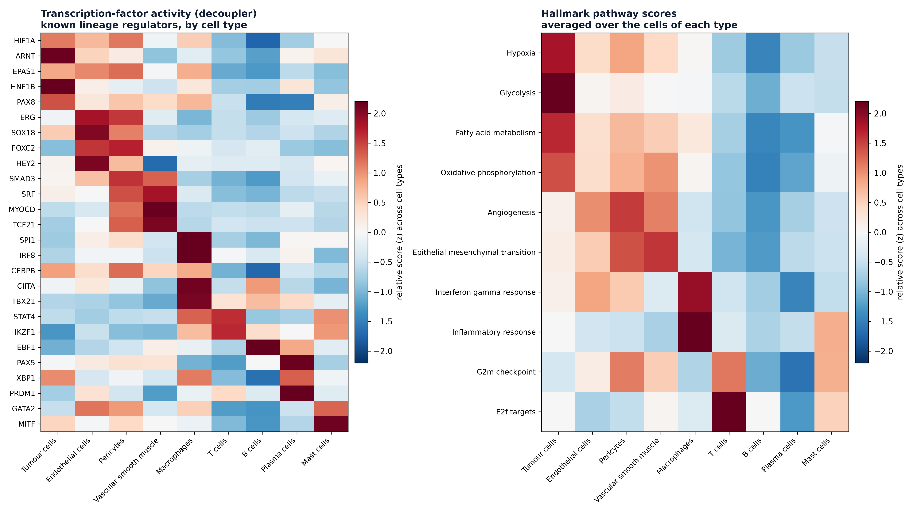

**Figure 12.** Left: activity of known lineage transcription factors in each cell type, inferred from the expression of their target genes (decoupler with the CollecTRI network). Right: Hallmark pathway scores per cell type.

1. **Each cell type is run by its expected regulators** (Figure 12, left). This is a check that the method works, as well as a description:
   - **Tumour cells:** **HNF1B** and **PAX8**, the regulators of kidney tubule cells from which ccRCC arises, and **ARNT**, the partner of the hypoxia factors HIF-1α and HIF-2α. HIF1A itself is high in the tumour cells and the pericytes.
   - **Endothelial cells:** ERG, SOX18 and HEY2. **Pericytes:** SMAD3 and FOXC2. **Vascular smooth muscle:** MYOCD, SRF and TCF21.
   - **Macrophages:** SPI1 (PU.1), IRF8 and CIITA. **T cells:** IKZF1 and STAT4. **B cells:** EBF1. **Plasma cells:** PRDM1 (BLIMP-1) and XBP1. **Mast cells:** MITF and GATA2.
2. **The tumour cells carry the metabolic programme seen in bulk tissue** (Figure 12, right). Hypoxia (2.0-fold enrichment among their marker genes, adjusted p = 4 × 10⁻¹⁰), glycolysis and fatty acid metabolism are highest in the tumour cells, the same switch found in the [bulk](https://github.com/MultiOmics-Intelligence/lsma-lab-bulk-rnaseq-kidney-cancer-tcga-kirc), [proteomics](https://github.com/MultiOmics-Intelligence/lsma-lab-proteomics-kidney-cancer-cptac) and [metabolomics](https://github.com/MultiOmics-Intelligence/lsma-lab-metabolomics-kidney-cancer) analyses. Angiogenesis is highest in pericytes and endothelium, and the interferon-γ response in macrophages.

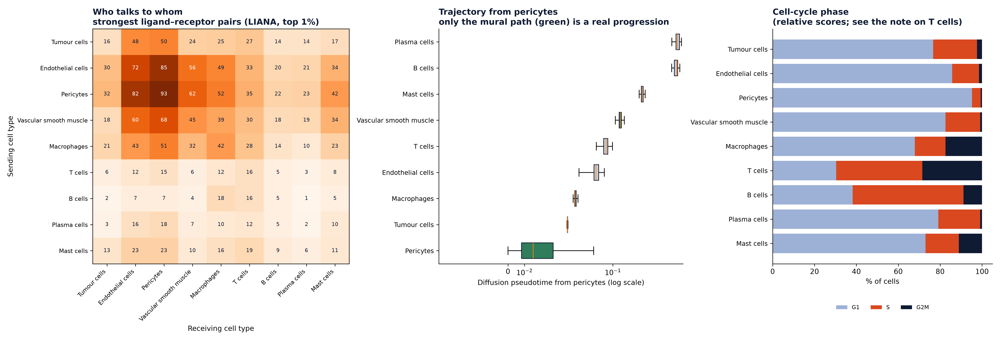

**Figure 13.** Left: number of strong ligand–receptor pairs between each sending and receiving cell type (LIANA consensus, top 1% by magnitude). Middle: diffusion pseudotime from pericytes. Right: cell-cycle phase per cell type.

3. **Cell-cell communication** (Figure 13, left).
   - **The blood-vessel wall is the busiest hub.** Pericytes, endothelial cells and smooth muscle send and receive the most strong signals, in keeping with the dense vasculature of ccRCC.
   - **Tumour cells signal to the vessels and to immune cells.** To endothelial cells and pericytes they send VEGFA (to ITGB1), SPP1 (osteopontin, to integrins and S1PR1) and TIMP1. To macrophages and T cells they send SPP1 and VIM (both to CD44), MIF (to CD74–CXCR4) and CXCL14 (to CXCR4).
   - **Antigen presentation to T cells.** Tumour cells, macrophages and endothelial cells present HLA class I to the T-cell receptor complex (HLA-B to CD3D, HLA-A/B to CD8A).
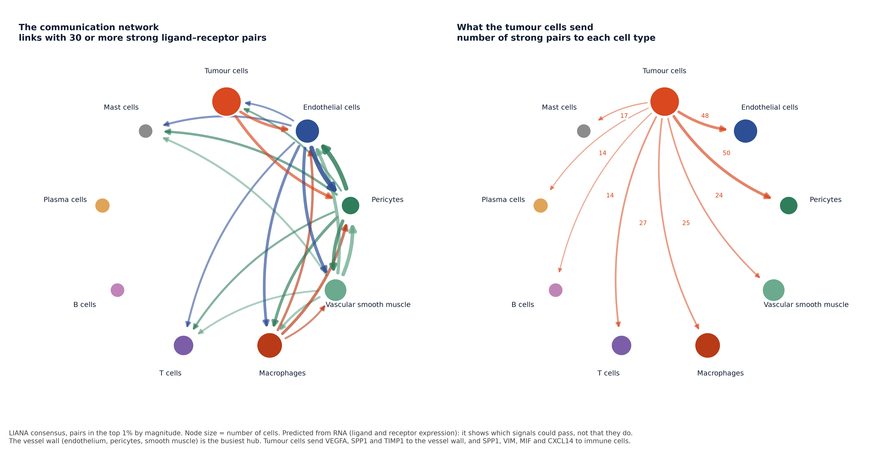

**Figure 14.** The cell-cell communication network. Left: links with 30 or more strong ligand–receptor pairs; arrow width shows how many. Right: what the tumour cells send to each cell type.

4. **Trajectory** (Figure 13, middle). Pseudotime was started from the pericytes. Vascular smooth muscle cells follow them, which fits the known continuum of mural cells around blood vessels. The other cell types are unrelated lineages; their position on the pseudotime scale only reflects how far they are from pericytes, and it is **not** a developmental path. A tumour of mature cell types has no single trajectory; this module is most useful where cells really progress, for example in development or in T-cell exhaustion within one lineage.
5. **Cell cycle** (Figure 13, right). 23% of tumour cells score in S or G2/M, and 32% of macrophages (the authors also found a dividing macrophage group). T and B cells score highest (70% and 62%). These are relative scores: they compare cells within this dataset, and for small or very different populations such as lymphocytes they are easily inflated. Only proliferation markers such as *MKI67* could confirm active division.

Tables in [`results/advanced/`](results/advanced): `tf_activity_by_cell_type.tsv`, `lineage_tf_activity_z.tsv`, `hallmark_pathways_by_cell_type.tsv`, `hallmark_scores_by_cell_type.tsv`, `cell_communication_liana.tsv` (top 5,000 pairs), `communication_counts_top1pct.tsv`, `pseudotime_by_cell_type.tsv`, `cell_cycle_phase_by_cell_type.tsv`.

---

## Quality control and PCA

Before any biology, every cell is checked. Single-cell data always contain empty droplets, broken cells and doublets (two cells captured together), and these have to be found and removed.

### Quality control
The lab sets thresholds **separately for each patient**, at the median ± a few median absolute deviations of genes detected, total counts and mitochondrial share. That matters here:
- One patient (SS_2017) was sequenced less deeply: a median of about 850 genes per cell, against 2,000–2,600 for the others (Figure QC1).
- A single fixed cut-off would have thrown most of that patient's cells away. Per-patient thresholds keep the cells that are good for that sample.

| | |
|---|---|
| 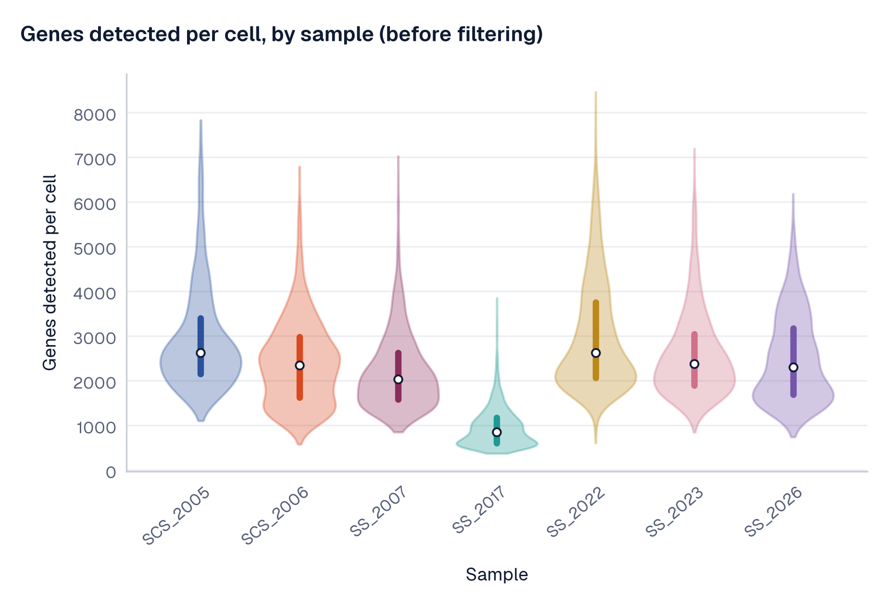 **QC1.** Genes detected per cell, for each patient. | 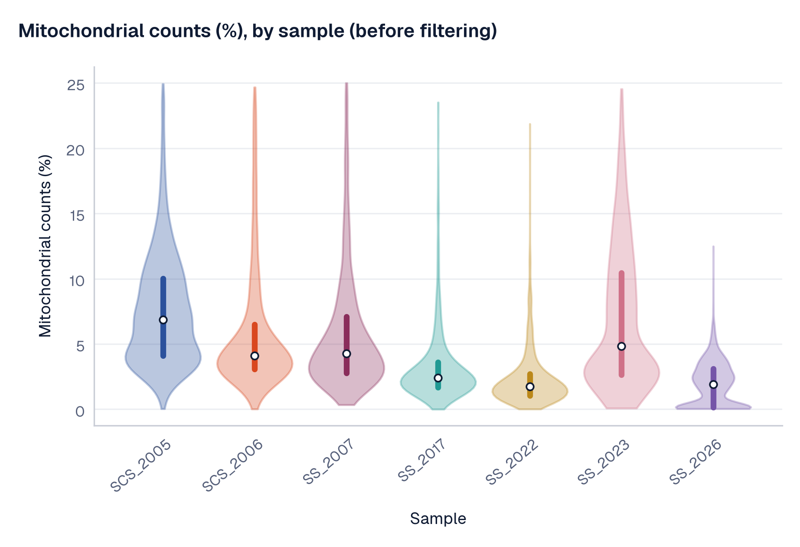 **QC2.** Mitochondrial share per cell: high values mark damaged cells. |
| 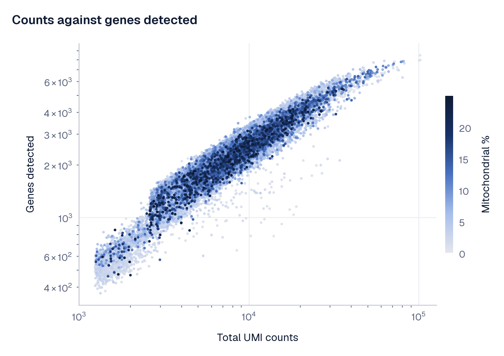 **QC3.** Counts against genes. Healthy cells lie on one smooth band. | 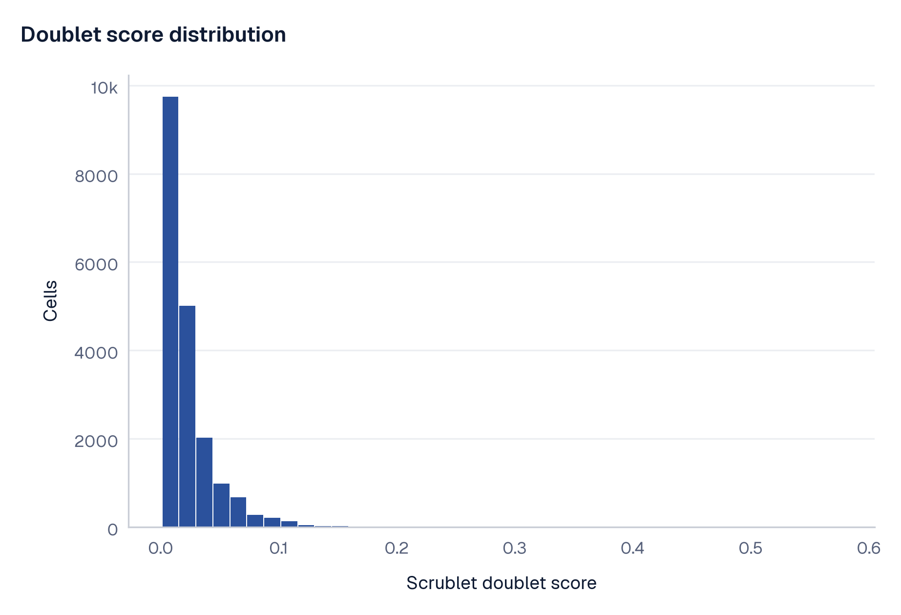 **QC4.** Scrublet doublet scores. |

**The result:**
- 1,313 low-quality cells (6.4%) and 7 doublets were removed, leaving **19,189 cells** and 23,308 genes.
- The median remaining cell has 2,171 genes, 7,286 counts and 3.1% mitochondrial reads.
- The per-patient thresholds are in [`results/qc_thresholds.tsv`](results/qc_thresholds.tsv). The total counts per patient and the counts-against-mitochondria plot are in [`figures/`](figures).

### PCA
PCA condenses the 2,000 most variable genes into a few axes that capture most of the difference between cells. The first 30 components were used for clustering (Figure P1, scree plot).

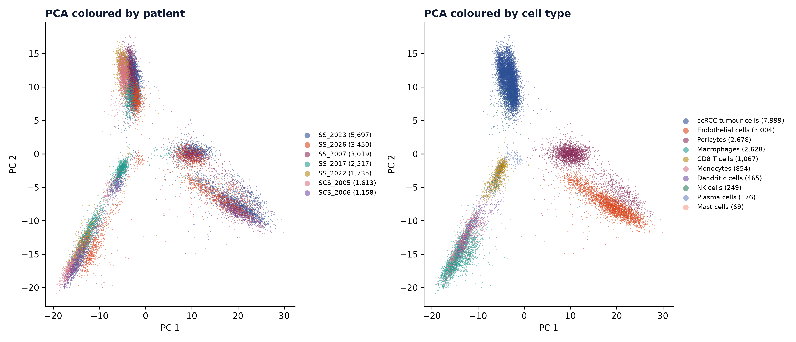

**Figure P2.** PC1 against PC2 for all 19,189 cells, coloured by patient (left) and by cell type (right).

Even before integration, the cells fall into **three arms**, and the genes that drive each axis explain them:

| Direction | Cells | Top genes on that side |
|---|---|---|
| PC2 positive | **Tumour cells** | *KRT8*, *NNMT*, *NDUFA4L2*, *CRYAB*, *CD24* |
| PC1 positive | **Vessel and stromal cells** (endothelium, pericytes) | *COL4A1*, *SPARC*, *SPARCL1*, *IGFBP7*, *EPAS1* |
| Both negative | **Immune cells** (myeloid and T cells) | *TYROBP*, *AIF1*, *FCER1G*, HLA class II genes |

The patients mix within the immune and vessel arms but less within the tumour arm, which is the first sign that each patient's cancer cells are distinct (see Key findings). The lab also checks whether a component simply tracks a technical measure such as sequencing depth (Figure P3).
- **PC1 and PC2 follow biology:** their correlation with depth, genes detected, mitochondrial or ribosomal share and doublet score is weak (|ρ| ≤ 0.27).
- **Some later components carry technical signal:** PC4 partly tracks depth and genes detected (ρ ≈ 0.5), PC5 the mitochondrial share (−0.59), and PC6 the ribosomal share (0.58).

That is normal. Because these components are among the 30 used, the per-patient quality thresholds and the check that clusters are not defined by depth alone matter.

| | |
|---|---|
| 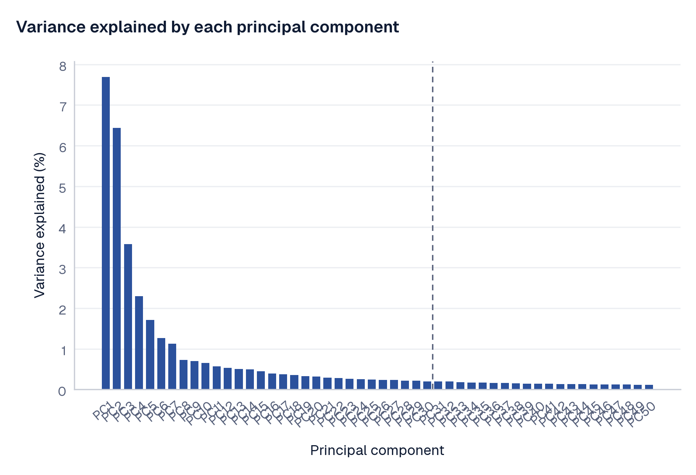 **P1.** Variance explained by each component. | 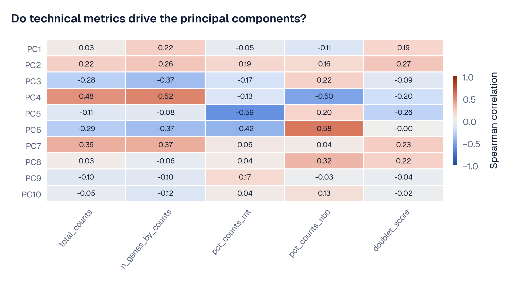 **P3.** Correlation of each component with technical measures. |

---

## Figures

| | |
|---|---|
| 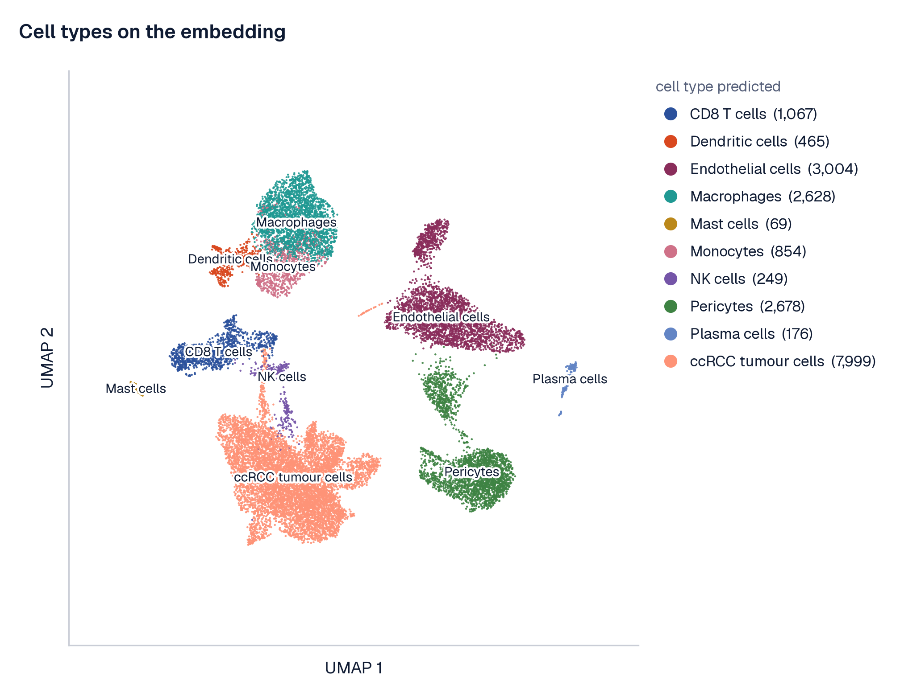 **Figure 1.** The ten cell populations on the UMAP. | 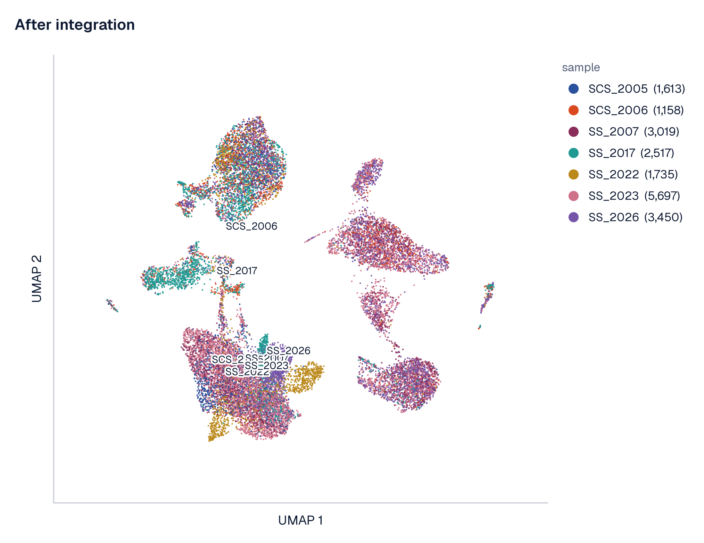 **Figure 3.** Cells coloured by patient after Harmony integration. |
| 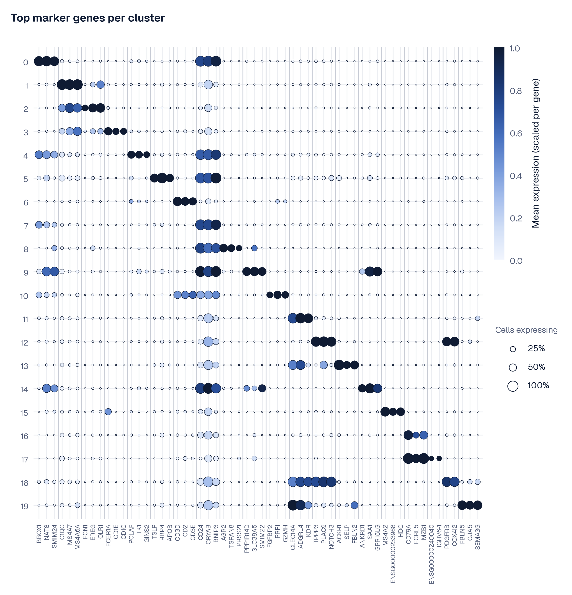 **Figure 6.** Top marker genes of each cluster. | 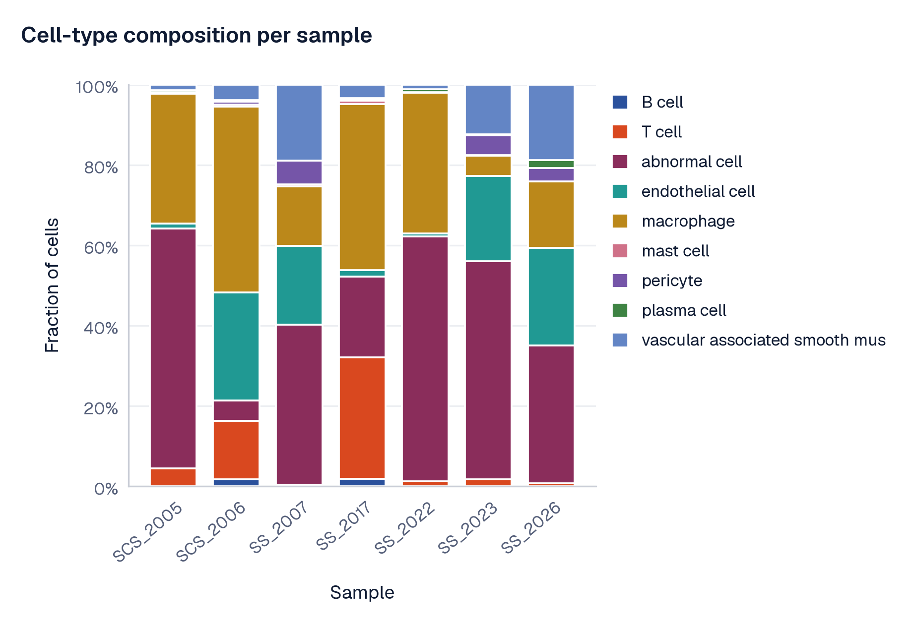 **Figure 9.** Cell-type composition of each patient's tumour. |
|  **Figure 12.** Transcription-factor activity and Hallmark pathways per cell type. |  **Figure 13.** Cell-cell communication, trajectory from pericytes and cell-cycle phase. |
|  **Figure 14.** The cell-cell communication network, and what the tumour cells send. | |

All 13 figures are in [`figures/`](figures), as PNG (300 dpi) and vector PDF:

| File | What it shows |
|---|---|
| 01 | Cell types on the UMAP |
| 02, 03 | Cells by patient before and after integration |
| 04 | Integration diagnostics |
| 05 | Clusters on the UMAP |
| 06 | Marker dot plot |
| 07 | Supporting marker genes for each label |
| 08 | Marker-set scores |
| 09 | Composition by patient |
| 10 | Quality-control filtering |
| 12 | Transcription-factor activity (lineage regulators) and Hallmark pathway scores per cell type |
| 13 | Cell-cell communication, pseudotime from pericytes and cell-cycle phase |
| 14 | Cell-cell communication network |

## The full report

The lab's own report covers every stage, including the optional ones: what was done, why, the checks, the results and their limits. The communication network (Figure 14) is added as a final appendix page. It's available as a [**PDF**](report/LSMA-Analysis-Lab-report-kidney-cancer-single-cell.pdf) or as [**HTML**](report/LSMA-Analysis-Lab-report-kidney-cancer-single-cell.html) (download it and open it in a browser for the interactive version).

## Summary tables ([`results/`](results))

| File | Contents |
|---|---|
| `cluster_annotation.tsv` | Each of the 20 clusters: size, label, confidence, runner-up, and the panel markers that support it |
| `cluster_marker_genes.tsv` | The top data-driven marker genes of each cluster (Wilcoxon test, Benjamini–Hochberg) |
| `cluster_composition_by_sample.tsv` | How many cells of each patient fall in each cluster |
| `qc_thresholds.tsv` | The quality-control thresholds used for each patient |
| `advanced/tf_activity_by_cell_type.tsv` | Activity of every transcription factor in each cell type (decoupler, CollecTRI) |
| `advanced/lineage_tf_activity_z.tsv` | The lineage regulators shown in Figure 12, scaled across cell types |
| `advanced/hallmark_pathways_by_cell_type.tsv` | Hallmark pathways enriched among each cell type's marker genes |
| `advanced/hallmark_scores_by_cell_type.tsv` | Mean Hallmark score per cell type |
| `advanced/cell_communication_liana.tsv` | The top 5,000 ligand–receptor pairs between cell types (LIANA consensus) |
| `advanced/communication_counts_top1pct.tsv` | Number of strong pairs between each sending and receiving cell type |
| `advanced/pseudotime_by_cell_type.tsv` | Diffusion pseudotime from pericytes, summarised per cell type |
| `advanced/cell_cycle_phase_by_cell_type.tsv` | Cells in G1, S and G2/M per cell type |

---

## Workflow

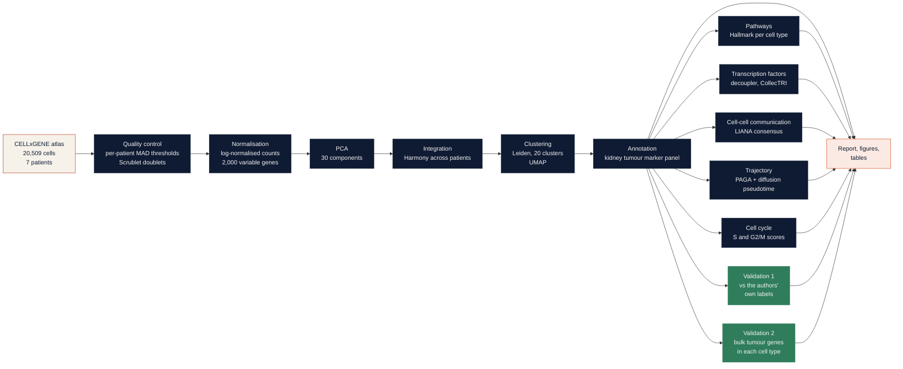

## How it was done

Every step below is a stage in the LSMA Analysis Lab, run with the settings in [`settings/analysis-settings.json`](settings/analysis-settings.json) (random seed 42).

1. **Import.**
   - The atlas was found in the lab's public data search and imported from CELLxGENE: 20,509 cells, 32,088 genes, 7 patients.
   - Raw counts were taken from the file's raw layer.
   - The authors' own cell labels were kept beside the lab's.
2. **Quality control.**
   - Thresholds were set per patient, at median ± MAD of genes detected, counts and mitochondrial share.
   - Doublets were flagged with Scrublet per patient.
   - 1,313 low-quality cells and 7 doublets were removed, leaving 19,189 cells and 23,308 genes. The median cell has 2,171 genes and 3.1% mitochondrial reads.
3. **Normalisation.**
   - Counts were normalised to 10,000 per cell and log-transformed.
   - 2,000 highly variable genes were chosen per patient (Seurat v3 method).
4. **Dimensionality reduction.** PCA (30 of 50 components), a neighbour graph (15 neighbours), and UMAP and t-SNE.
5. **Integration.** Harmony corrected the PCA embedding across the 7 patients:
   - Patient mixing rose from 0.13 to 0.60.
   - Separation of the authors' cell types rose from 0.26 to 0.45, so cell types were kept apart.
   - Clusters made of a single patient fell from 11 to 3.
6. **Clustering.** Leiden at resolution 0.8 gave 20 clusters. Marker genes were found by the Wilcoxon test against all other cells.
7. **Annotation.**
   - Each cluster was scored against a kidney-tumour marker panel. Tumour cells: CA9, NDUFA4L2, ANGPTL4, PAX8, CP, NNMT. Panels also covered T, NK, B and plasma cells, macrophages, monocytes, dendritic and mast cells, endothelium, pericytes, smooth muscle, fibroblasts and proliferating cells.
   - Each label is reported with its confidence and the panel markers that are also data-driven markers of the cluster.

8. **Extended run (optional stages).**
   - **Interpretation:** Hallmark over-representation among each cell type's marker genes, and Hallmark scores per cell.
   - **Transcription factors:** decoupler with the CollecTRI regulons.
   - **Communication:** LIANA consensus of several methods, with 100 permutations.
   - **Trajectory:** PAGA and diffusion pseudotime, rooted at the pericytes.
   - **Cell cycle:** Scanpy's S and G2/M gene scores.

**Software:** Scanpy, Harmony and Scrublet, in the versions listed in [`settings/analysis-settings.json`](settings/analysis-settings.json).

> **Note on the marker panel.** The lab's default panel at the time was designed for blood (PBMC). On this tumour it labelled the cancer cells as blood-cell types, because it contains no epithelial, endothelial or stromal markers. The lab now chooses the panel automatically from the tissue and disease a dataset names, and on this atlas it picks its new **Tumour microenvironment** panel. Choosing a panel that fits the tissue is the most important decision in marker-based annotation.

---

## Validation

### 1. Against the authors' own labels
The original authors labelled every cell by hand. The lab's labels were compared with theirs cell by cell (the authors' fine groups were merged into the same broad types, e.g. both endothelial subtypes as "endothelial"). Lab and authors agree for **98.4% of the 19,189 cells**:

| The authors' label | Cells | Agreement with the lab |
|---|---|---|
| Tumour | 8,065 | 98.4% |
| Macrophages | 3,973 | 99.2% (the lab splits them further into macrophages, monocytes and dendritic cells) |
| Endothelial (PLVAP, ACKR1) | 3,023 | 98.9% |
| Vascular smooth muscle | 2,103 | 100% |
| T cells, CD8 T cells | 1,158 | 99.9% |
| Pericytes | 586 | 97.6% |
| Plasma cells | 115 | 100% |
| Mast cells | 63 | 100% |
| B cells | 68 | 0% (labelled plasma cells) |
| Dividing macrophages | 35 | 11% |

The lab missed two very small groups: 68 B cells, which joined the plasma cells, and 35 dividing macrophages. Full tables: [`validation/agreement_by_author_label.tsv`](validation/agreement_by_author_label.tsv) and [`validation/lab_vs_author_labels.tsv`](validation/lab_vs_author_labels.tsv).

### 2. Against the bulk kidney cancer analysis
The [bulk analysis](https://github.com/MultiOmics-Intelligence/lsma-lab-bulk-rnaseq-kidney-cancer-tcga-kirc) found the 100 genes most strongly higher in tumours than in normal kidney (24 TCGA patients, validated in a second cohort). 86 of them are measured here. If the bulk signal comes from the cancer cells, those genes should be highest in the tumour cells. They are: a mean expression of 0.42 in tumour cells, against 0.24 for the next cell type (endothelium) and 0.05 for CD8 T cells (Figure V1).

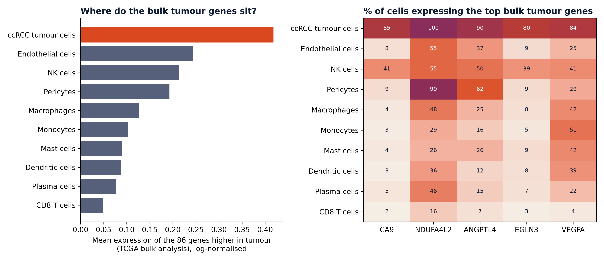

**Figure V1.**
- **Left:** mean expression of the 86 bulk "tumour" genes in each cell type.
- **Right:** the percentage of cells in each cell type expressing the top hypoxia genes.

The genes lower in tumours in the bulk analysis (normal tubule genes such as *UMOD* and *SLC12A1*) are almost absent here: these samples contain tumour, not normal kidney.

**Verdict:** the labels are confirmed by the authors' independent annotation, and the cell-level picture explains the bulk result.

The comparison script is [`validation/validate_against_authors_and_bulk.py`](validation/validate_against_authors_and_bulk.py).

---

## Limitations

- **One small cluster is mixed.** The 249 cells labelled "NK cells" are half the authors' T cells and half tumour cells, and 41% of them express *CA9*. They are probably tumour–immune doublets that escaped doublet detection, or cells caught in contact. They're kept and flagged, not interpreted as NK cells.
- **Small populations are hard to label.** 68 B cells and 35 dividing macrophages weren't recognised by the panel.
- **Tumour cells aren't proven malignant.** "Tumour cells" are identified by markers (*CA9*, *PAX8* and the hypoxia genes), not by their DNA. Copy-number inference, such as the loss of chromosome 3p, would confirm malignancy.
- **Ambient RNA wasn't corrected.** That needs the unfiltered droplet data, which the public file doesn't include.
- **The extended stages use the dataset's broad labels.** The lab's advanced modules group cells by the dataset's own cell types when it has them, so monocytes, dendritic cells and macrophages are one group there, and a monocyte-to-macrophage trajectory couldn't be rooted. Letting these modules use the lab's own labels is a planned improvement to the lab.
- **Communication is predicted, not measured.** Ligand–receptor scores show which signals could pass between cell types from their RNA, not that they do.
- **Seven patients.** Proportions vary from patient to patient (Figure 9), and seven tumours can't represent all ccRCC.
- **A teaching example, not clinical advice.** These results are for education and must not be used to diagnose or treat anyone.

---

## Repository structure

```
lsma-lab-single-cell-kidney-cancer-ccrcc/
├── README.md                  this case study
├── LICENSE                    CC BY 4.0
├── assets/
│   └── lsma-lab-kidney-single-cell-banner.svg     animated banner
├── report/                    the LSMA Analysis Lab's full report
│   ├── LSMA-Analysis-Lab-report-kidney-cancer-single-cell.pdf
│   └── LSMA-Analysis-Lab-report-kidney-cancer-single-cell.html
├── figures/                   key figures, PNG (300 dpi) and vector PDF
│   ├── qc-pca-*                          quality control (violins, scatter, doublets) and PCA (scree, PC vs QC, PCA plot)
│   ├── 01-annotation-embedding           ·  02/03-integration-embedding_before/after
│   ├── 04-integration-integration_metrics ·  05-clustering-embedding
│   ├── 06-clustering-marker_dotplot      ·  07-annotation-supporting_markers
│   ├── 08-annotation-annotation_scores   ·  09-annotation-cell_type_composition
│   ├── 12-advanced-tf_activity_and_pathways · 13-advanced-communication_trajectory_cell_cycle
│   ├── 14-advanced-communication_network
│   └── 10-qc-filtering
├── results/                   summary tables (tab-separated)
│   ├── cluster_annotation.tsv
│   ├── cluster_marker_genes.tsv
│   ├── cluster_composition_by_sample.tsv
│   ├── advanced/              transcription factors, pathways, communication, pseudotime, cell cycle
│   └── qc_thresholds.tsv
├── validation/                checks against the authors and the bulk analysis
│   ├── validation-bulk-genes-in-single-cells.png / .pdf
│   ├── agreement_by_author_label.tsv
│   ├── lab_vs_author_labels.tsv
│   ├── bulk_tumour_genes_by_cell_type.tsv
│   ├── bulk_marker_genes_fraction_expressing.tsv
│   └── validate_against_authors_and_bulk.py
└── settings/
    ├── analysis-settings.json           every parameter, the marker panel and the random seed
    └── analysis-settings-extended.json  the extended run with the optional stages
```

## Why we share this analysis

This is one of a series of worked examples from the **LSMA Analysis Lab**, published openly for five reasons:

- **To show what the lab does, on real data.** Each repository takes one public dataset through one lab module, from import to report, and shows every step, figure and setting. Nothing is hidden or polished after the fact: the report here is the one the lab produced.
- **To teach a complete analysis, not just a result.** Students see the parts that are usually skipped: quality control, the choice of statistics, an independent validation, and an honest list of limitations.
- **To earn trust by checking known biology first.** These analyses deliberately reproduce findings that are already well established, such as the hypoxia programme and the Warburg switch in kidney cancer. A method that gets the known answers right can be trusted with new questions.
- **To keep testing our own tools.** Every example is a real-world test of the lab. Running public data from start to finish shows what works and what needs fixing, and the fixes go back into the lab for every student. Improvements from this series so far: a more reliable import from NCBI GEO, automatic choice of the right cell-type markers for each tissue in single-cell analysis, and removal of sex-chromosome probes and a more robust DIABLO model in multi-omics.
- **To make the work open and repeatable.** The data are public, every parameter and software version is listed, and diploma students can repeat the same analysis in the lab themselves.

The series follows one cancer, clear cell kidney cancer, through every layer: genes, single cells, DNA methylation, enhancers, mutations, proteins, metabolites and lipids, all of them together in the [multi-omics analysis](https://github.com/MultiOmics-Intelligence/lsma-lab-multi-omics-kidney-cancer-tcga-kirc), and predictions from tumour RNA in the [machine learning analysis](https://github.com/MultiOmics-Intelligence/lsma-lab-machine-learning-kidney-cancer-tcga-kirc). Each repository links to the others.

These examples are for education and must not be used for medical decisions.

## Data source and credits

- **Data:** Zhang Y, Narayanan SP, Mannan R, et al. Single-cell analyses of renal cell cancers reveal insights into tumor microenvironment, cell of origin, and therapy response. *PNAS* 2021;118(24):e2103240118 (PMID 34099557). Accessed through [CELLxGENE Discover](https://cellxgene.cziscience.com/e/be39785b-67cb-4177-be19-a40ee3747e45.cxg/). No raw data are copied into this repository.
- **Methods:**
  - Wolf, Angerer & Theis, *Genome Biology* 2018 (Scanpy)
  - Korsunsky et al., *Nature Methods* 2019 (Harmony)
  - Wolock, Lopez & Klein, *Cell Systems* 2019 (Scrublet)
  - Traag, Waltman & van Eck, *Scientific Reports* 2019 (Leiden)
- **Companion analyses:** [kidney cancer vs matched normal kidney, bulk RNA-seq](https://github.com/MultiOmics-Intelligence/lsma-lab-bulk-rnaseq-kidney-cancer-tcga-kirc) · [the kidney cancer methylome](https://github.com/MultiOmics-Intelligence/lsma-lab-dna-methylation-kidney-cancer-tcga-kirc) · [active enhancers, ChIP-seq](https://github.com/MultiOmics-Intelligence/lsma-lab-chip-seq-kidney-cancer-enhancers) · [somatic mutations and copy number](https://github.com/MultiOmics-Intelligence/lsma-lab-somatic-mutations-kidney-cancer-tcga-kirc) · [the kidney cancer proteome](https://github.com/MultiOmics-Intelligence/lsma-lab-proteomics-kidney-cancer-cptac) · [the kidney cancer metabolome](https://github.com/MultiOmics-Intelligence/lsma-lab-metabolomics-kidney-cancer) · [the kidney cancer lipidome](https://github.com/MultiOmics-Intelligence/lsma-lab-lipidomics-kidney-cancer) · [multi-omics](https://github.com/MultiOmics-Intelligence/lsma-lab-multi-omics-kidney-cancer-tcga-kirc) · [machine learning](https://github.com/MultiOmics-Intelligence/lsma-lab-machine-learning-kidney-cancer-tcga-kirc).

## Run it yourself

Diploma students of the London School of Multiomics & AI can repeat this analysis in the **LSMA Analysis Lab**:
1. **Public data** → CELLxGENE → search *renal cell carcinoma*.
2. Import the *ccRCC* atlas.
3. Run **Single-cell RNA-seq** with integration across `sample`. The annotation panel is now chosen automatically.

Find out more about the diplomas at [lsma.co.uk](https://lsma.co.uk).

## Licence

The text, figures and tables in this repository are shared under [Creative Commons Attribution 4.0 (CC BY 4.0)](https://creativecommons.org/licenses/by/4.0/): you may reuse them with credit to the London School of Multiomics & AI. The underlying data remain under the CELLxGENE dataset licence, with credit to the original authors.

---

**Dr. Anas Alzaeem**, Academic Director, London School of Multiomics & AI


